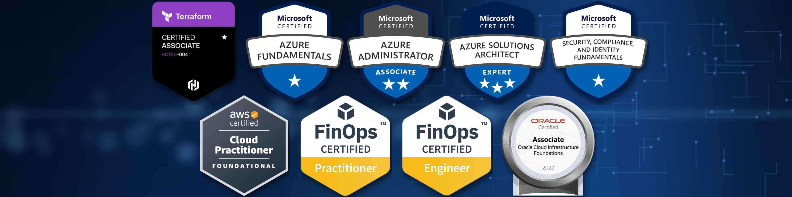

# Olá, pessoas 👋

**Cloud | Terraform | DevOps | IaC | Azure | AWS | FinOps**

---

### 🚀 Sobre mim

Profissional de **Cloud** com mais de 8 anos em TI, 3 deles dedicados a ambientes **multicloud** (Azure, AWS, GCP e OCI). Atuo na interseção entre **infraestrutura, automação e custos**: deixo a nuvem governada, automatizada e financeiramente eficiente.

- 💰 **FinOps:** análise de custos, rightsizing, reservas e identificação de desperdícios, com automações que cruzam métricas de consumo e custo e medem o saving real.
- 🛡️ **Governança e compliance:** TAGs obrigatórias para rastreabilidade e showback por time e aplicação, Azure Policy para impor padrões e manter o ambiente em conformidade, RBAC e hierarquia de Management Groups.
- ⚙️ **DevOps e DevSecOps:** pipelines CI/CD com SonarQube e Gitleaks, automação de ambientes com GitHub Actions, Argo CD e AKS.
- 🌱 **Agora:** aprofundando em **IaC com Terraform**, Git e GitHub, GitHub Actions e automação de deploy com OIDC.

### 💼 Experiência

**Cloud & FinOps · ambientes multicloud** (3 anos)

- Sustentação de ambientes Azure, AWS, GCP e OCI, apoiando FinOps e DevOps com foco em estabilidade e eficiência.
- Reestruturação de **mais de 300 subscriptions** no Azure, com nova hierarquia de Management Groups e boas práticas de governança.
- Comitês de custo com estratégias de rightsizing, reservas e otimização de recursos.
- Pipelines CI/CD com SonarQube e Gitleaks em projetos DevSecOps; automações com GitHub Actions, Argo CD e AKS.
- 🏆 Ferramenta de gestão de custos **vencedora do campeonato interno de tecnologia** da empresa.

**Suporte técnico** (5 anos)

### 🛠 Tecnologias

**Cloud** 

**IaC, DevOps e DevSecOps** 

**FinOps e Governança** 

### 📈 Atividade no GitHub

  
  

### 👻 Pac-Man das contribuições

<picture>
  <source media="(prefers-color-scheme: dark)" srcset="https://raw.githubusercontent.com/rafabiasotto/rafabiasotto/output/pacman-contribution-graph-dark.svg">
  <source media="(prefers-color-scheme: light)" srcset="https://raw.githubusercontent.com/rafabiasotto/rafabiasotto/output/pacman-contribution-graph.svg">
  
</picture>

